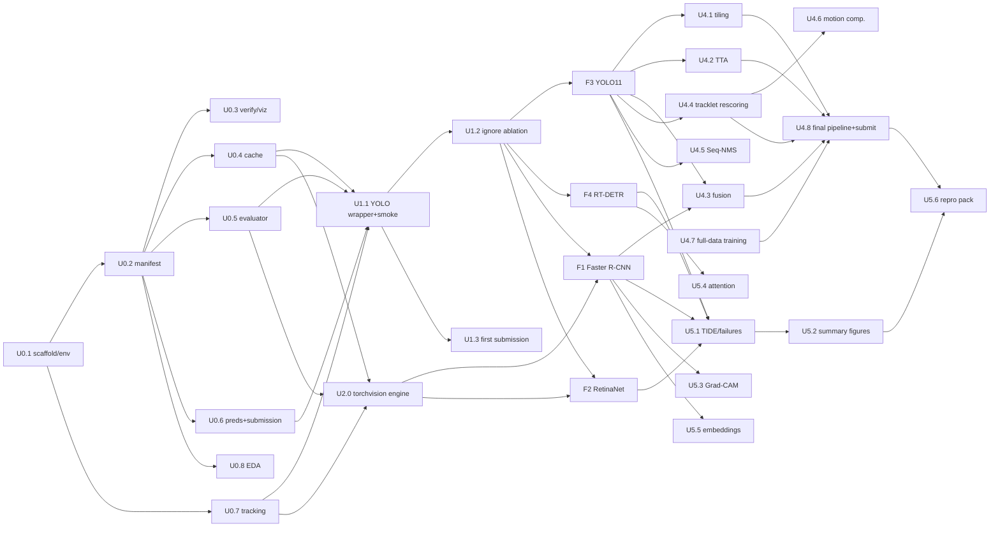

# PROJECT BLUEPRINT — Multiple-Object Video Detection (UCU AI 2026, HW2)

> **This file is the single source of truth for the project.** Anyone (human or AI agent) joining the repository should read it in full before writing code.
> - Part I defines the problem and the evaluation.
> - Part II defines the architecture, the data/file contracts and a board of decoupled work units.
>
> Any decision that changes a **contract** (§6) or the **fixed protocol** (§7) must be recorded in the Decision Log (§13).

---

## Table of contents

- **Part I — Domain & Competition Specification**
  1. Task definition
  2. Dataset anatomy
  3. Evaluation specification
  4. Grading constraints that shape the engineering
- **Part II — Modular Implementation Plan**
  5. Repository architecture
  6. Contracts (schemas every unit must respect)
  7. Fixed experimental protocol (P0)
  8. Environments & compute
  9. Experiment tracking (local, in-repo)
  10. Work-unit board (M0–M6)
  11. Runtime & compute summary
  12. Collaboration workflow & conventions
  13. Decision log & open risks

---

# PART I — DOMAIN & COMPETITION SPECIFICATION

## 1. Task definition

| Aspect | Specification |
|---|---|
| Competition | Kaggle `multiple-object-video-detection-hw-2-ucu-ai-2026` (UCU AI 2026, HW2) |
| Source data | VisDrone2019-VID: video clips filmed from drones at different altitudes, viewing angles (oblique to near-nadir), scenes and lighting. |
| Task | **Frame-level multi-object detection.** For every test frame, predict boxes with class and confidence. |
| Tracking | **Not scored.** Track IDs are not submitted. Temporal information may still be used *internally*, e.g. for score rescoring (bonus, §10 M4). |
| Difficulty | Objects are **small** (often 10–30 px on test frames), **dense** (up to 180 per frame), frequently **occluded or truncated**, and shown at varying scales and viewpoints. |
| Classes | 8 (see §2.3). |
| Leaderboard | Public and private test sets are split **per clip** (48 test clips). Expect public LB noise. Final submissions are chosen on **local holdout mAP**, not public LB alone. |
| Submission limit | 5 per day. |

## 2. Dataset anatomy

### 2.1 Splits

These numbers were verified on the local copy.

| Split | Clips | Frames | Labelled boxes | Boxes/frame (mean / median / max) | Frames with ignore regions | Size on disk |
|---|---|---|---|---|---|---|
| train | 56 | 24,201 | 1,105,516 | 45.7 / 43 / 180 | 18,090 (75%) | 7.5 GB |
| val | 7 | 2,846 | 114,132 | 40.1 / 37 / 116 | — | 1.5 GB |
| test | 48 | 3,811 | (hidden) | — | — | 0.8 GB |

- Clip lengths: train 58–1,424 frames (median 384), val 184–978, **test 35–148**.
- Frame numbers are consecutive within each clip (verified: no gaps).
- Val clip names: `uav0000086_00000_v`, `uav0000117_02622_v`, `uav0000137_00458_v`, `uav0000182_00000_v`, `uav0000268_05773_v`, plus 2 others (see manifest).

### 2.2 File layout

```text
data/
├── train/  (same layout for val/)
│   ├── images/<clip>/<frame:07d>.jpg
│   ├── labels/<clip>/<frame:07d>.txt     # YOLO: "cls cx cy w h", normalised [0,1], cls 0-based
│   ├── ignore/<clip>/<frame:07d>.txt     # "cx cy w h", normalised, no class; only frames that have regions
│   ├── annotations_coco.json             # same labels in COCO format (see below)
│   └── data.yaml                         # Ultralytics config (nc=8)
├── test/images/<clip>/<frame:07d>.jpg    # clip names: clip_001 … clip_048
└── test_images.csv                       # image_id,file_name,clip,frame,width,height
```

On Kaggle, `sample_submission.csv` (all predictions empty, scores 0) is also part of the competition data.

**COCO json details:**
- `bbox = [x, y, w, h]` in **pixels**, with (x, y) the top-left corner.
- `category_id` is **1-based** (1 = person … 8 = motor).
- Extra annotation fields: `truncation` (0/1), `occlusion` (0/1/2), `track_id`, `orig_category_id` (the original 10+2-class VisDrone id).
- `images` entries carry `video`, `video_id` and `frame_id`.
- Ignore regions are annotations with `iscrowd=1` (and `ignore=1`).

### 2.3 Class ontology and the 8-class mapping

| id (YOLO / submission, 0-based) | COCO `category_id` | Class | Original VisDrone ids merged | Train share | Val share |
|---|---|---|---|---|---|
| 0 | 1 | person | 1 pedestrian + 2 people | 29.7% | 44.1% |
| 1 | 2 | bicycle | 3 | 3.6% | 5.3% |
| 2 | 3 | car | 4 | **45.7%** | 27.9% |
| 3 | 4 | van | 5 | 4.2% | 6.0% |
| 4 | 5 | truck | 6 | 2.8% | 1.2% |
| 5 | 6 | tricycle | 7 tricycle + 8 awning-tricycle | 3.7% | 4.8% |
| 6 | 7 | bus | 9 | **0.9%** | **0.2%** |
| 7 | 8 | motor | 10 | 9.3% | 10.5% |
| — (ignore region) | `iscrowd=1` | — | 0 ignored-region + 11 others | — | — |

- **Imbalance:** car and person dominate. Bus, truck, tricycle and bicycle are rare, so per-class AP will be noisy. Note that val has only 264 bus boxes.
- **Train and val class mixes differ** (person 30% vs 44%). Expect a domain gap between the two.

### 2.4 Coordinate conventions (MUST be followed)

| Context | Format |
|---|---|
| YOLO labels / Ultralytics | `cls cx cy w h`, normalised by image W/H, cls 0–7 |
| COCO GT json | `[x_min, y_min, w, h]` pixels, `category_id` 1–8 |
| **Internal prediction table (§6.3)** | `x, y, w, h` in **pixels of the original image**, top-left corner, `cls` 0–7 |
| **Submission** | `cls score x y w h` groups, **top-left, original-image pixels**, cls 0–7 |

**Rules:**
- Every model output is converted back to original-image pixels **before** evaluation or submission.
- Boxes are clipped to `[0, W] × [0, H]`. Boxes with `w ≤ 0` or `h ≤ 0` are discarded.

### 2.5 Resolution shift between train/val and test (key domain fact)

| Split | Resolutions (W×H) |
|---|---|
| train (per clip) | 1344×756 (11), **1904×1071 (30)**, 2688×1512 (11), 2720×1530 (2), 1920×1080 (1), 1360×765 (1) |
| val (per clip) | 1344×756 (2), 1904×1071 (2), 2688×1512 (1), 2720×1530 (1), **3840×2160 (1)** |
| test (per frame) | **1360×764 (1,474)**, 1920×1080 (991), 1344×756 (441), **680×382 (321)**, 1904×1072 (305), **960×540 (279)** |

Test frames are at most 1920 px wide, and about 16% are ≤ 960 px. They look like **downscaled** VisDrone frames, so objects are smaller in pixels at test time than in train.

**What this changes:**
- Augmentation (§7) is biased toward random **downscaling**.
- Inference runs at an **upscaled** `imgsz` and uses tiling (M4).
- Results are reported per test-like resolution bucket where possible.

### 2.6 Object size statistics (train, native resolution)

- Box area: p10 = 576 px² (~24×24), **median = 2,100 px² (~46×46)**, p90 = 10,323 px².
- COCO size buckets: **small 24.9%**, medium 63.5%, large 11.6%. Val: 19.2 / 69.5 / 11.3%.
- After resizing to a 1280 long side, the median train box is roughly 30 px and p10 roughly 15 px. Default COCO anchors (smallest 32 px) are too coarse (see M2/M3).

### 2.7 Ignore regions (verified; deduplication required)

- **Content:** crowds, dense parking lots and other areas too small or packed to annotate, plus VisDrone "others".
- **Scoring:** detections inside them **are not penalised**.
- **The 510k vs 64k mismatch is resolved:**
  - COCO json has 510,744 `iscrowd` entries; `ignore/*.txt` has 63,843 lines. Both cover exactly the **same 18,090 frames**.
  - In a 300-frame sample, every COCO crowd box matched a txt box with IoU > 0.9.
  - COCO simply stores **exact duplicate copies** of each region. Example: frame `uav0000013_00000_v/0000001` has 32 COCO crowd entries but only 4 unique regions.
  - **Policy:** use `ignore/*.txt` (or deduplicated COCO crowd boxes) as the source of truth. Our GT json for evaluation contains **deduplicated** crowd boxes.
- **Training policy** (decided by ablation in U1.2):
  - `drop`: original pixels; ignore regions are simply not targets.
  - `blur` (default candidate): heavy Gaussian blur with soft edges inside ignore regions.
  - In both policies the fill mask is **(ignore regions) minus (labelled GT boxes, dilated by 2 px)**, so labelled objects are never erased.
  - Val and test images used for evaluation/inference are **never** modified.

### 2.8 Temporal structure

- Footage runs at 25–30 fps, so neighbouring frames are highly redundant.
- Training uses **frame subsampling with step k** (k = 5 under the protocol). The value is justified by a redundancy analysis (U0.8): box displacement and IoU of the same `track_id` at lag k.
- `track_id` is available in train/val COCO (510 unique ids). It can be used to tune the temporal post-processing (M4).

## 3. Evaluation specification

### 3.1 Leaderboard metric (working assumption, to be calibrated in U1.3)

The competition pages do not name the metric explicitly. Everything points to COCO detection evaluation:
- the rubric asks for "mAP, AP50, AP_small";
- the data page notes that "marking ignored regions as iscrowd=1 makes the evaluator skip detections inside them";
- "at most 500 detections per image are scored".

| Item | Specification |
|---|---|
| Primary metric | **COCO mAP@[0.50:0.05:0.95]** (AP averaged over 10 IoU thresholds and 8 classes) |
| Detections | At most **500 per image** (`maxDets=500`). **Our evaluator must set `maxDets=[1, 10, 500]`.** The pycocotools default of 100 understates mAP in dense scenes. |
| Crowd handling | Ignore regions are GT with `iscrowd=1`. Detections matched to them (crowd IoU = intersection / det area) are neither TP nor FP. |
| Size buckets | small < 32², medium 32²–96², large > 96² (area in original pixels). |
| Secondary (reported) | AP50, AP75, AP_small/medium/large, per-class AP, AR@500, FPS. |

### 3.2 Local evaluator (U0.5)

- **Library:** `faster-coco-eval`. It is pycocotools-compatible and 3–10× faster. Use pycocotools only as a cross-check.
- **Ground truth:** built from `labels/` + `ignore/` (deduplicated).
  - `image_id` = `<clip>_<frame:07d>` mapped to an integer.
  - `area = w*h`.
  - `iscrowd = 1` for ignore regions.
- **Input:** the prediction table (§6.3).
- **Mandatory sanity checks** (`tests/test_eval.py`):
  1. GT boxes submitted as predictions (score 1.0) give **AP = 1.000**.
  2. Predictions placed only inside ignore regions add **zero FP**: AP is unchanged versus the same set without them.
  3. With 300 GT-derived detections per frame in a dense scene, AP must differ between `maxDets=100` and `maxDets=500`.
  4. Empty predictions give AP = 0.

### 3.3 Baseline and threshold criteria

- The grade is **cancelled** if the final submission doesn't beat the course baseline (its value isn't published). A valid, reasonable YOLO submission must be on the LB early (U1.3).
- At planning time the public LB top was 0.3465 (13 teams). This is context only.

### 3.4 Submission format

```text
image_id,PredictionString
clip_001_0000001,2 0.91 1366 580 26 44 0 0.55 809 625 29 66
clip_001_0000002,
```

- Exactly one row per `image_id` in `test_images.csv` (3,811 rows), in the same order.
- `PredictionString` = space-separated groups of `cls score x y w h`:
  - `cls` is an integer 0–7;
  - `score` is a float in (0, 1];
  - `x y w h` are pixels (float, 1–2 decimals).
- At most 500 groups per row. Sort by score descending and truncate.
- An empty string means no detections.
- Validated by `vdet.submission.validate()` before every upload.

## 4. Grading constraints that shape the engineering

| Rubric item | Points | Engineering consequence |
|---|---|---|
| Data understanding & preprocessing | 1.00 | EDA (U0.8): class balance, sizes, density **per sequence**, ignore handling, GT visualisation, justification for k, reproducible preprocessing. |
| Two-stage anchor-based | 1.00 | Faster R-CNN (F1): baseline + 2 experiments. Report mAP/AP50/AP_small/FPS, the role of the RPN vs the RoI head, and **≥3 failure cases**. |
| One-stage anchor-based | 1.00 | RetinaNet (F2): anchors grounded in EDA, focal/assignment tuning, comparison with tuned F1, discussion of removing the proposal stage. |
| One-stage anchor-free | 1.00 | YOLO11 (F3): ≥2 tuned parameters with search range, location assignment explained, results **by object size**, comparison with F1/F2. |
| Query-based | 0.75 | RT-DETR (F4): **same compute budget**, queries/matching/denoising tuning, **val mAP over training vs a CNN detector**, convergence statement. |
| Your pipeline | 1.25 | M4: data-strategy and inference-strategy gains measured **separately**, plus a final summary comparison of all models. |
| Report | 2.00 | **Written by the team (no AI-written report).** ≈1,500 words. Experiments link to code. Run instructions, seeds, dependencies. |
| Private LB | 2.00 | Normalised 0.5–2.0 by rank. |
| Bonus: temporality | +1 | U4.4/U4.5: previous-frame information improves the current frame. |
| Bonus: visualisation | +1 | U5.3–U5.5: Grad-CAM, attention, embeddings, with interpretation. |
| Bonus: custom architecture | +≤3 | Optional: e.g. a P2 high-resolution head (YOLO) with full ablation evidence. |

**Rule applied to every model family (team decision):** baseline + **Exp A** (hyperparameter or architecture variation) + **Exp B** (loss or matching variation), all under protocol P0 (§7).

> [!WARNING]
> **The visualisation bonus text requires logging to Weights & Biases** ("You must log your training runs and visualizations to W&B … share a link"). The team decided **not** to use W&B; all tracking stays local (§9). This may forfeit or reduce the visualisation bonus. Mitigation: the local logs follow a W&B-like structure, so a later one-off upload (`wandb sync` or a short import script) remains possible if the team changes its mind. See Decision Log D-07.

**Repository rules (hard):**
- **Never modify `index.html`, `assets/` or `.github/`.** Doing so annuls the grade.
- The report lives in `report.md`; its figures live in `images/`.
- Both partners must make meaningful commits.
- Any push after the deadline makes the whole submission late (−50%).

---

# PART II — MODULAR IMPLEMENTATION PLAN

## 5. Repository architecture

```text
ucu-ai-hw-2/
├── index.html  assets/  .github/        # TEMPLATE CORE — NEVER MODIFY
├── report.md                            # team-written report (published via GitHub Pages)
├── images/                              # report figures (exported by notebooks/scripts; PNG, ≤ 300 KB each)
├── PROJECT_BLUEPRINT.md                 # this file
├── README_CODE.md                       # how to install, prepare data, train, predict, submit (U5.6)
├── pyproject.toml                       # package `vdet` (src layout), `pip install -e .`
├── requirements.txt                     # pinned versions (recorded at U0.1)
├── .gitignore                           # data/, cache/, runs/, checkpoints/, submissions/, *.pt, *.pth, large preds
│
├── configs/
│   ├── paths.yaml                       # per-environment roots (local_wsl / kaggle / colab)
│   ├── protocol.yaml                    # fixed protocol P0 (§7) — changes require a Decision Log entry
│   ├── data/
│   │   ├── cache_k5_blur.yaml           # cache build recipes
│   │   └── cache_k5_drop.yaml
│   ├── faster_rcnn/{e0_base,e1_rpn_proposals,e2_giou}.yaml
│   ├── retinanet/{e0_base,e1_kmeans_anchors,e2_focal_assign}.yaml
│   ├── yolo/{e0_base,e1_imgsz1600,e2_nwd}.yaml
│   ├── rtdetr/{e0_base,e1_queries,e2_matching_dn}.yaml
│   ├── ultralytics_models/              # custom model yamls (e.g. rtdetr-l with nq=600, yolo11s-p2)
│   └── pipeline/final.yaml              # M4: tiling / TTA / fusion / temporal settings
│
├── src/vdet/
│   ├── __init__.py
│   ├── paths.py                         # environment auto-detection → pathlib roots (P.data, P.cache, P.runs …)
│   ├── constants.py                     # class names, COCO↔YOLO id maps, VisDrone orig-id map
│   ├── utils.py                         # seeding, timing, gpu info, git hash, yaml io
│   ├── data/
│   │   ├── manifest.py                  # build/load manifest.parquet (§6.1); ignore dedup
│   │   ├── gt.py                        # build COCO GT json (dedup crowd) for any split / frame subset
│   │   ├── cache.py                     # subsample + resize + ignore policy (drop | blur) → cache dir (§6.2)
│   │   ├── export_ultra.py              # cache → Ultralytics dataset yaml
│   │   ├── datasets.py                  # torch Dataset/collate for torchvision models (reads cache)
│   │   ├── augment.py                   # torchvision-path augmentations (albumentations, bbox-safe)
│   │   └── redundancy.py                # frame-step analysis (track displacement / IoU at lag k)
│   ├── models/
│   │   ├── tv_builders.py               # Faster R-CNN v2 / RetinaNet v2 builders from config
│   │   ├── tv_patches.py                # small, unit-tested overrides (GIoU RoI loss, focal α/γ, ignore-aware matching)
│   │   ├── anchors.py                   # k-means anchor fitting (IoU distance) on cached-scale boxes
│   │   ├── ultra.py                     # Ultralytics train/predict wrappers, custom trainer hooks
│   │   └── losses.py                    # NWD, GIoU/DIoU/CIoU helpers
│   ├── engine/
│   │   └── train_tv.py                  # torchvision training loop (refs/detection style; AMP, warmup, time budget)
│   ├── eval/
│   │   ├── coco_eval.py                 # faster-coco-eval wrapper, maxDets=500, crowd, per-size/per-class
│   │   ├── speed.py                     # FPS benchmark protocol (§7)
│   │   └── errors.py                    # TIDE breakdown + failure-case mining
│   ├── infer/
│   │   ├── predictors.py                # uniform `Predictor` interface: frames → prediction table (§6.3)
│   │   ├── tiling.py                    # model-agnostic slicing + merge (SAHI-style)
│   │   ├── tta.py                       # hflip / multi-scale TTA
│   │   └── fusion.py                    # NMS, Soft-NMS, WBF (per-class), cross-model ensembling
│   ├── temporal/
│   │   ├── linking.py                   # IoU / motion-compensated frame-to-frame association → tracklets
│   │   ├── rescoring.py                 # tracklet score smoothing + gap propagation
│   │   ├── seqnms.py                    # Seq-NMS
│   │   └── motion.py                    # optional camera-motion compensation (ECC / homography, OpenCV)
│   ├── tracking/                        # LOCAL experiment tracking (§9) — no external services
│   │   ├── run.py                       # RunLogger: creates run dir, writes config/env/metrics/summary
│   │   ├── ultra_adapter.py             # converts Ultralytics results.csv → metrics.csv schema
│   │   ├── aggregate.py                 # experiments/runs/*/summary.json → experiments/results.csv
│   │   └── plots.py                     # training curves, mAP-vs-GPU-time, per-size bars, PR curves
│   ├── submission.py                    # prediction table → CSV; strict validator
│   └── viz.py                           # GT/pred/ignore overlays, grids, clip strips, failure galleries
│
├── scripts/                             # thin CLIs; every script takes --config and writes a run dir
│   ├── prepare_manifest.py              # U0.2
│   ├── verify_data.py                   # U0.3
│   ├── build_cache.py                   # U0.4
│   ├── train_ultra.py                   # F3/F4 (+ U1.x)
│   ├── train_tv.py                      # F1/F2
│   ├── predict.py                       # any checkpoint → preds parquet (val or test), optional tiling/TTA
│   ├── evaluate.py                      # preds parquet → eval json (+ summary update)
│   ├── fuse.py                          # WBF / ensembling of preds parquets
│   ├── temporal.py                      # temporal post-processing of preds parquet
│   ├── benchmark_speed.py               # FPS protocol
│   ├── make_submission.py               # preds parquet → validated CSV in submissions/
│   └── aggregate_results.py             # regenerate experiments/results.csv
│
├── notebooks/                           # THIN: autoreload, call into vdet, show compact results
│   ├── 00_env_bootstrap.ipynb           # Kaggle/Colab: clone, install, set paths, attach cache
│   ├── 01_eda_preprocessing.ipynb       # U0.8 (+ U0.3 figures)
│   ├── 10_yolo_baseline_ignore_ablation.ipynb   # U1.1–U1.3
│   ├── 21_faster_rcnn.ipynb             # F1
│   ├── 22_retinanet.ipynb               # F2
│   ├── 23_yolo11.ipynb                  # F3
│   ├── 24_rtdetr.ipynb                  # F4
│   ├── 30_inference_strategies.ipynb    # U4.1–U4.3
│   ├── 31_temporal.ipynb                # U4.4–U4.6
│   ├── 32_final_pipeline.ipynb          # U4.7–U4.8
│   ├── 40_error_analysis.ipynb          # U5.1–U5.2
│   └── 41_visualization_bonus.ipynb     # U5.3–U5.5
│
├── experiments/                         # COMMITTED tracking data (§9)
│   ├── runs/<run_id>/…                  # one folder per run (small files only)
│   ├── results.csv                      # GENERATED by scripts/aggregate_results.py — never hand-edit
│   └── lb.csv                           # manual: run_id, submission file, public LB score, date
│
├── tests/                               # pytest, CPU-only, < 2 min total
│   ├── test_conversion.py  test_eval.py  test_submission.py  test_fusion.py  test_temporal.py
│
├── data/            # (gitignored) raw competition data
├── cache/           # (gitignored) built caches
├── runs/            # (gitignored) raw framework outputs (Ultralytics runs/, tv checkpoints)
├── checkpoints/     # (gitignored) best weights; shared via private Kaggle Dataset / Google Drive
└── submissions/     # (gitignored) CSVs; filenames referenced from experiments/lb.csv
```

**Separation of concerns:**
- `src/vdet` holds **all logic**.
- `scripts/` are **thin CLIs**: parse arguments, load config, call `vdet`, write a run dir. They are runnable from a terminal or a notebook cell (`!python scripts/...`).
- `notebooks/` orchestrate and **present** results. No logic longer than ~15 lines lives in a notebook cell.

**Notebook header (mandatory):**

```python
%load_ext autoreload
%autoreload 2
from vdet.paths import P          # resolves data/cache/runs roots for local_wsl | kaggle | colab
```

**Notebook hygiene (graded):**
- Every section starts with a short markdown cell.
- Training logs are suppressed or condensed (`verbose=False`, tqdm off). Show summary tables and plots instead.
- No runtime errors left in committed outputs.
- Paths always use `pathlib.Path`. Never hard-code OS-specific separators.

## 6. Contracts (schemas every unit must respect)

These contracts let units be developed independently. A unit may only depend on another unit through these artefacts.

### 6.1 `manifest.parquet` (U0.2) → `cache/manifest.parquet`

One row per frame (train, val, test):

| column | type | notes |
|---|---|---|
| `image_key` | str | `<clip>_<frame:07d>` (test: equals `image_id` in `test_images.csv`) |
| `split` | str | `train` / `val` / `test` |
| `clip` | str | |
| `frame` | int | 1-based |
| `path` | str | relative to data root, POSIX (e.g. `train/images/uav…/0000001.jpg`) |
| `width`, `height` | int | original size |
| `n_boxes` | int | labelled boxes (NaN for test) |
| `n_ignore` | int | deduplicated ignore regions |
| `ignore_area_frac` | float | union area of ignore regions / image area |
| `res_bucket` | str | e.g. `1904x1071` |
| `cls_counts` | list[int] (len 8) | per-class counts |

Companion files:
- `cache/boxes.parquet`: one row per labelled box. Columns `image_key, cls, x, y, w, h` (original pixels), plus `track_id, occlusion, truncation` (joined from COCO).
- `cache/ignore.parquet`: one row per **deduplicated** ignore region. Columns `image_key, x, y, w, h`.

### 6.2 Cache layout (U0.4) → `cache/<cache_name>/`

```text
cache/k5_blur_L1920/
├── recipe.yaml                    # exact build params + git hash + source manifest hash
├── index.parquet                  # image_key, split, cache_path, orig_w, orig_h, scale
├── train/images/<clip>_<frame>.jpg  + train/labels/<clip>_<frame>.txt   # YOLO normalised labels
├── val/images/… + val/labels/…    # val k=5 subset, NO ignore fill (used only for in-training curves)
├── data.yaml                      # Ultralytics dataset config (absolute path written at runtime)
└── coco_train.json, coco_val.json # COCO json in cached coordinates (torchvision path)
```

- **Resize:** long side → `L` (default 1920; never upscale). JPEG quality 95. Labels are normalised, so they don't depend on scale.
- **Ignore policy:**
  - `drop`: pixels untouched.
  - `blur`: Gaussian blur σ ≈ 0.25 · min(region w, h) (≥ 8 px), with a feathered mask edge of about 6 px, applied over (ignore ∖ dilated GT).
- **Frame subsampling:** keep frames with `(frame - 1) % k == 0` for train. Val in-training subset uses the same rule with k = 5.
- **Final evaluation never uses the cache.** Predictors read **original** val/test images (§6.3).

### 6.3 Prediction table (all predictors) → `*.parquet` (zstd)

| column | type | notes |
|---|---|---|
| `image_key` | str | must exist in the manifest |
| `cls` | int8 | 0–7 |
| `score` | float32 | (0, 1] |
| `x`, `y`, `w`, `h` | float32 | **original-image pixels**, top-left |
| `source` | str (optional) | e.g. `yolo-e1`, `tile`, `tta-flip`, used for fusion diagnostics |
| `track` | int32 (optional) | filled by temporal units |

- **Production defaults:** `conf ≥ 0.001` and top 500 per image, since low-score detections still add to AP.
- **For committing:** a slim version with `score ≥ 0.05` (`preds_val_slim.parquet`, typically < 15 MB) may be committed in the run dir. Full files go to shared storage.

### 6.4 Run directory (every training, prediction or evaluation job) → `experiments/runs/<run_id>/`

```text
<run_id>/                         # run_id = <family>-<exp>-<YYYYMMDD-HHMM>, e.g. yolo-e1-20261105-1412
├── config.yaml                   # fully resolved config (protocol + overrides)
├── env.json                      # git commit, dirty flag, python/torch/ultralytics versions, GPU, seed, host (kaggle/colab/local)
├── metrics.csv                   # per-epoch: epoch, gpu_time_h, lr, train loss terms…, val_AP, val_AP50, val_APs (proxy)
├── eval_val.json                 # FINAL evaluation with OUR evaluator on full val (all metrics, per-class, per-size, AR@500)
├── speed.json                    # FPS protocol output (if run)
├── summary.json                  # flat dict consumed by aggregate.py (see §6.5)
├── notes.md                      # 2–5 lines: hypothesis, change vs parent run, outcome (facts only)
└── plots/*.png                   # small diagnostic plots (≤ 300 KB each)
```

Checkpoints are **not** committed. `summary.json` stores `checkpoint_uri` (Kaggle Dataset path or Drive path).

### 6.5 `experiments/results.csv` (GENERATED, never hand-edited)

```text
run_id, unit, family, exp, parent_run, hypothesis, cache, imgsz, k, epochs_done, gpu_h, gpu_type,
AP, AP50, AP75, APs, APm, APl, AR500, fps, ap_person…ap_motor, lb_public, commit, date
```

- `lb_public` is joined from `experiments/lb.csv`.
- Generating this file (rather than editing it) **prevents merge conflicts**: each run only adds its own folder.

### 6.6 Submission CSV → `submissions/<run_id>[_<tag>].csv`

As in §3.4. It must pass `vdet.submission.validate(csv, test_images_csv)`, which checks:
- row count and order;
- id set;
- class range;
- score range;
- ≤ 500 dets per row;
- finite numbers;
- `w, h > 0`;
- boxes within image bounds (±1 px).

## 7. Fixed experimental protocol (P0) — `configs/protocol.yaml`

All four family comparisons (M2–M3) use these settings. Deviations belong to M4 ("Your pipeline") or need a Decision Log entry.

| Parameter | Value |
|---|---|
| Train data | `train` split only (56 clips), frame step **k = 5** → ≈ 4,850 frames |
| Holdout | **Official `val` (7 clips), all 2,846 frames**, original images, evaluated with our evaluator (§3.2) |
| In-training curves | val k = 5 subset (≈ 570 frames), cache images without fill. Used as a **proxy** for curves only. |
| Ignore policy | winner of U1.2 (`blur` by default until U1.2 is done) |
| Cache | `k5_<policy>_L1920` |
| Input size | **long side 1280** (Ultralytics `imgsz=1280`; torchvision `min_size=720, max_size=1280`) |
| Init | COCO-pretrained weights (all families) |
| Compute budget per run | **1.5 GPU-h on a single T4**, including in-training validation. Enforced via Ultralytics `time=1.5` and `train_tv.py --time-budget-h 1.5`. The number of epochs reached is recorded. |
| Optimiser / schedule | family defaults (documented in the config). Warmup ≈ 1 epoch. Cosine or step decay fitted to the budget. |
| Augmentation | hflip 0.5; scale jitter biased to downscale (Ultralytics `scale=0.5`; torchvision random resize of the long side in [0.5, 1.0]·1280); light HSV. **No vertical flip or rotation.** Ultralytics keeps its default mosaic (documented as a framework difference). Mosaic is closed for the final 10% of the budget. |
| Inference | `conf=0.001`, NMS IoU 0.6 (CNN families), `max_det=500`, same 1280 long side |
| Seed | 42 (data order, augmentation, init where applicable) |
| FPS protocol | T4, batch 1, FP16, 1280 long side, model forward + post-processing (NMS), JPEG decode **excluded**, 20 warm-up + 200 timed val frames, median latency → FPS |
| Reported metrics | AP, AP50, AP75, AP_s/m/l, AR@500, per-class AP, FPS, GPU-h, epochs reached |

## 8. Environments & compute

### 8.1 Environments

| Env | Role | Notes |
|---|---|---|
| **Local WSL 2 (Ubuntu), RTX 4050 Laptop 6 GB** | Development, unit tests, smoke tests (overfit ~20 images), cache building, CPU post-processing, evaluation | **Copy `data/` into the WSL ext4 filesystem** (e.g. `~/vdet/data`, 10 GB). Reading 27k files via `/mnt/c` is 5–10× slower. Python 3.11 venv (`uv venv -p 3.11`), torch + CUDA 12.x wheels. Set `VDET_ENV=local_wsl`, `VDET_DATA=~/vdet/data`. |
| **Kaggle Notebook, T4 (16 GB) ×1/×2, ~30 GPU-h/week per account** | All training runs and heavy inference | Competition data is mounted at `/kaggle/input/multiple-object-video-detection-hw-2-ucu-ai-2026/`. Built caches are published once as a **private Kaggle Dataset** (e.g. `vdet-cache-k5-blur`) and attached as input, so no GPU time is spent on caching. Work dir `/kaggle/working` (≤ 20 GB). Sessions last ≤ 12 h. Run training via `!python scripts/...` (needed for DDP on T4×2). Two partners give two quotas, about **60 GPU-h/week combined**. |
| **Google Colab free, T4/L4** | Overflow training, inference, fusion/temporal sweeps | Data via `kaggle competitions download` (~10 GB, ~5–10 min) into `/content`, or the cache from Drive. Sessions are preemptible, so **checkpoint every epoch to Drive**. |

`vdet.paths` detects the environment from `VDET_ENV`, or from the existence of `/kaggle/input` or `/content`, and resolves `P.data`, `P.cache`, `P.runs`, `P.ckpt` and `P.subs` from `configs/paths.yaml`.

### 8.2 Relative speed assumptions used for estimates

All estimates are **±50%**. Each training script prints measured throughput and an ETA after 50 iterations; recalibrate §11 after the first run of each family.

| Hardware | Relative training throughput | Max practical batch @1280 |
|---|---|---|
| T4 16 GB (FP16) | 1.0× (reference) | YOLO11s 8, RT-DETR-L 4, Faster R-CNN v2 4, RetinaNet v2 4 |
| RTX 4050 Laptop 6 GB (FP16) | ~0.9–1.2× per image, but **memory-bound** | 1–2, so smoke tests only |
| Kaggle T4 ×2 (DDP) | ~1.7× | 2× the above (final runs only; P0 runs use a single T4 for comparability) |
| Colab L4 24 GB | ~1.8–2.2× | ~1.5× the T4 batch |

## 9. Experiment tracking (local, in-repo, no external services)

**Goals:**
- Every run is reproducible and comparable.
- All curves and figures the report needs (including the bonus) can be regenerated from committed files.

1. **`vdet.tracking.run.RunLogger`** (used by every script):
   - creates `experiments/runs/<run_id>/`;
   - writes `config.yaml` and `env.json` at start;
   - appends to `metrics.csv` each epoch;
   - writes `summary.json` at the end.
2. **Ultralytics runs:**
   - Training writes to `runs/` (gitignored).
   - `ultra_adapter.py` converts `results.csv` into our `metrics.csv` (box/cls/dfl losses, proxy mAP50-95/mAP50, lr, and cumulative `gpu_time_h` from epoch times).
   - It copies `args.yaml` into `config.yaml` (merged) and keeps a few small Ultralytics plots (PR curve, confusion matrix) in `plots/`.
   - **Proxy-metric caveat:** Ultralytics' in-training mAP uses its own matcher (no ignore regions, `max_det` 300). It is valid for YOLO-vs-RT-DETR curve comparisons (same evaluator) but **not** as a headline number. Headline numbers always come from `eval_val.json`.
3. **torchvision runs:** `train_tv.py` evaluates the val k=5 subset with **our** evaluator each epoch (≈ 1–2 min) and logs it to `metrics.csv`.
4. **Plots** (`vdet.tracking.plots`, exported by notebooks to `images/` with stable names):
   - `curves_<family>.png`: loss + proxy mAP vs epoch and vs GPU-hours;
   - `map_vs_gpu_time_all.png`: the required query-based vs CNN plot;
   - `size_breakdown.png`: AP_s/m/l per family;
   - `map_vs_fps.png`;
   - `per_class_ap.png`;
   - `ignore_ablation.png`;
   - `pipeline_waterfall.png`: M4 incremental gains.
5. **Aggregation:** `python scripts/aggregate_results.py` regenerates `experiments/results.csv` (seconds).
6. **Size limits:** committed run folders should stay ≤ 20 MB each. Use `git lfs` **only** if the team explicitly decides to (not planned).

## 10. Work-unit board (M0–M6)

**How to use this board:**
- Pick any unit whose **Depends on** units are done.
- Create a branch `unit/<ID>-<slug>`, implement it, meet the **Done when** criteria, and open a PR to `main`.
- Status is tracked as one GitHub Issue per unit (title = unit ID + name), so the board stays editable without merge conflicts.
- Each unit lists runtime estimates for **T4** and **local RTX 4050** (L4050). "CPU" means the job needs no GPU.



> Before U1.2 finishes, F1–F4 *code* (wrappers, configs, smoke tests) can already be developed using the `blur` cache. Only the **official P0 runs** wait for the U1.2 decision.

---

### M0 — Foundations (all CPU-friendly; mostly local)

#### U0.1 Repository scaffold & environments
- **Deliverables:**
  - `pyproject.toml` (package `vdet`, src layout) and `requirements.txt` with exact pins recorded from the working Kaggle image: torch/torchvision (as provided), `ultralytics` (8.3.x, YOLO11 + RT-DETR), `faster-coco-eval`, `pycocotools`, `ensemble-boxes`, `albumentations`, `opencv-python-headless`, `pandas`, `pyarrow`, `scikit-learn`, `matplotlib`, `tidecv`, `grad-cam`, `umap-learn`, `pytest`.
  - `.gitignore`, `src/vdet/{paths,constants,utils}.py`, `configs/paths.yaml`, `configs/protocol.yaml`.
  - `notebooks/00_env_bootstrap.ipynb`, WSL setup instructions (in `README_CODE.md`).
- **Done when:**
  - `pip install -e .` works on WSL, Kaggle and Colab.
  - `python -c "from vdet.paths import P; print(P)"` prints correct roots in each environment.
  - `git status` shows no data or cache files.
  - `index.html`, `assets/` and `.github/` are untouched (`git diff --stat` on them is empty).
- **Runtime:** setup ≈ 30–45 min (WSL venv + CUDA torch download ~2.5 GB; copying data into WSL ext4 ≈ 5–10 min). Kaggle/Colab bootstrap cell ≈ 2–3 min.
- **Depends on:** —

#### U0.2 Manifest, class maps, ignore deduplication
- **Deliverables:** `vdet/data/manifest.py`, `scripts/prepare_manifest.py` → `cache/manifest.parquet`, `boxes.parquet`, `ignore.parquet` (§6.1).
- **Done when:**
  - Counts match §2.1 (frames 24,201 / 2,846 / 3,811; boxes 1,105,516 / 114,132).
  - Unique ignore regions per frame equal the `ignore/*.txt` line counts.
  - `track_id`, `occlusion` and `truncation` are joined from COCO for ≥ 99.9% of boxes.
- **Runtime:** CPU. WSL ext4 ≈ 3–5 min (reads ~57k small txt files plus the 280 MB COCO json, ~25 s to parse). On `/mnt/c` or Windows ≈ 10–12 min. RAM ≈ 3 GB peak (COCO json). Output ≈ 40 MB.
- **Depends on:** U0.1

#### U0.3 Data verification & visual debugging (`viz.py`)
- **Deliverables:**
  - `vdet/viz.py`: draw GT (class colours), ignore (hatched), predictions (score-filtered); grid and clip-strip helpers.
  - `scripts/verify_data.py`, `tests/test_conversion.py`.
- **Done when:**
  1. YOLO txt → pixels matches COCO bbox within 1 px for **every resolution bucket**.
  2. Deduplicated COCO crowd set equals the txt ignore set per frame (IoU > 0.99).
  3. A report of the share of GT boxes with IoA > 0.5 inside ignore regions, per class.
  4. A temporal-jump check on ignore regions (flag frames where an ignore region shifts > 20% of its size between consecutive frames).
  5. Figures saved to `images/`: `gt_grid_<bucket>.png` (one per resolution), `ignore_worst_frames.png` (highest coverage), `clip_strip_<clip>.png` (30 consecutive frames, alignment over time), and `cache_vs_original.png` (after U0.4).
- **Runtime:** CPU ≈ 5 min, plus manual inspection ≈ 30 min.
- **Depends on:** U0.2 (and U0.4 for the cache comparison figure)

#### U0.4 Offline cache builder (blur / drop) + Ultralytics export
- **Deliverables:** `vdet/data/{cache,export_ultra}.py`, `scripts/build_cache.py`, `configs/data/cache_k5_{blur,drop}.yaml`. Implements §6.2, including the GT-protecting fill mask.
- **Done when:**
  - Two caches are built: `k5_blur_L1920` and `k5_drop_L1920`.
  - `data.yaml` loads in Ultralytics (`yolo val` dry run on 10 images).
  - A random 20-frame visual check shows no GT erased.
  - `recipe.yaml` records all parameters.
  - Both caches are uploaded as private Kaggle Datasets.
- **Runtime (per cache):**
  - CPU, multiprocessing (4–8 workers). About 4,850 train + 570 val frames, decoding up to 2720×1530 JPEGs.
  - **Local WSL ≈ 5–8 min. Kaggle CPU (4 cores) ≈ 8–12 min.**
  - Disk ≈ 2.0–2.5 GB per cache. Kaggle Dataset upload ≈ 5–10 min.
  - The final k=2 cache (U4.7) is ≈ 13.5k frames (train+val): ≈ 15–25 min, ≈ 5–6 GB.
- **Depends on:** U0.2

#### U0.5 Evaluator
- **Deliverables:**
  - `vdet/data/gt.py` (COCO GT json for any split or subset, deduplicated crowd).
  - `vdet/eval/coco_eval.py` (`evaluate(preds_df, split, subset=None) -> dict`; maxDets=[1,10,500]; per-class; per-size; AR@500; optional per-resolution-bucket breakdown).
  - `scripts/evaluate.py`, `tests/test_eval.py` (all four sanity checks in §3.2).
- **Done when:** tests pass; GT-as-prediction gives 1.000; a pycocotools cross-check on one prediction file agrees within 0.002.
- **Runtime:** CPU. Full val with 500 dets/frame (~1.4M dets): **faster-coco-eval ≈ 1–2 min**, pycocotools ≈ 8–15 min. RAM ≈ 4–6 GB. The val k=5 subset takes ≈ 15 s.
- **Depends on:** U0.2

#### U0.6 Prediction table I/O + submission writer/validator
- **Deliverables:**
  - `vdet/infer/predictors.py`: base `Predictor` interface (`predict(frames) -> DataFrame`) and the helper that maps from letterboxed or resized coordinates back to the original.
  - `vdet/submission.py` (`to_csv`, `validate`), `scripts/make_submission.py`, `tests/test_submission.py`.
- **Done when:**
  - An empty submission and a synthetic random submission both pass `validate`.
  - A deliberately broken file (bad order, >500 dets, cls 8, NaN) is rejected with clear messages.
  - The round trip CSV → table → CSV is lossless (2-decimal tolerance).
- **Runtime:** CPU. Writing a 3,811-row submission with 500 dets/frame takes ≈ 20–40 s; file size ≈ 60–80 MB (uploading via `kaggle competitions submit` takes ≈ 1–2 min).
- **Depends on:** U0.2

#### U0.7 Local experiment tracking & plotting
- **Deliverables:** `vdet/tracking/{run,ultra_adapter,aggregate,plots}.py`, `scripts/aggregate_results.py`, `experiments/lb.csv` header (§6.4–6.5, §9).
- **Done when:**
  - A dummy run (fake metrics) produces a complete run dir.
  - `aggregate_results.py` produces `results.csv`.
  - `plots.curves()` and `plots.map_vs_gpu_time()` render from the dummy data.
  - The adapter converts a sample Ultralytics `results.csv`.
- **Runtime:** CPU, seconds.
- **Depends on:** U0.1

#### U0.8 EDA & preprocessing justification (rubric item 1)
- **Deliverables:** `notebooks/01_eda_preprocessing.ipynb` and `vdet/data/redundancy.py`. Figures in `images/`:
  - class distribution (train vs val);
  - object-size histograms (native and at 1280 scale) with COCO buckets;
  - boxes/frame distribution **per clip** (box plot);
  - per-clip class mix heat map;
  - resolution distribution for train/val/test;
  - ignore coverage per clip;
  - **frame-step redundancy**: median IoU of the same `track_id` between frame t and t+k, for k = 1…20, to justify k = 5;
  - box width/height scatter used later for anchors.
- **Done when:** each figure has a one-line factual observation and its downstream decision (input size, anchors, augmentation, k).
- **Runtime:** CPU ≈ 5–10 min (reads parquet artefacts only).
- **Depends on:** U0.2

---

### M1 — First baseline, ignore-policy decision, scoring calibration

#### U1.1 Ultralytics wrapper, YOLO training CLI, smoke test
- **Deliverables:**
  - `vdet/models/ultra.py`: train with P0 defaults (`imgsz=1280, time=1.5, seed=42, max_det=500, conf=0.001`, close mosaic at the end); predict on original images into the prediction table (§6.3); post-training hook calling `ultra_adapter`.
  - `scripts/train_ultra.py --config configs/yolo/e0_base.yaml`, `scripts/predict.py`.
- **Done when:**
  - **Local smoke test:** YOLO11n overfits 20 train images (proxy mAP50 > 0.8 within about 100 epochs at imgsz 640, batch 2).
  - `predict.py` → `evaluate.py` → `make_submission.py` runs end to end on 50 val frames.
- **Runtime:** smoke test on L4050 ≈ 5–8 min (VRAM ≈ 3 GB); end-to-end mini pipeline ≈ 2 min.
- **Depends on:** U0.4, U0.5, U0.6, U0.7

#### U1.2 Ignore-policy ablation (`drop` vs `blur`) — approved ~1 GPU-h
- **Setup:** YOLO11n, imgsz 1280, k = 10 subset of each cache (≈ 2,420 frames), `time=0.45` h each, same seed. Evaluate on the **full val** set with our evaluator.
- **Output:**
  - Two run dirs and `images/ignore_ablation.png` (AP, AP_s, and FP rate near ignore borders).
  - A Decision Log entry fixing the policy for P0.
  - Optional: a third arm with `blur` and a hard grey fill to show the artefact effect (+0.45 GPU-h).
- **Runtime:** **T4 ≈ 2 × 27 min training + 2 × 4 min val inference + 2 × 1.5 min eval ≈ 1.0 GPU-h.** Not practical locally (≈ 2× slower at batch 2).
- **Depends on:** U1.1

#### U1.3 First Kaggle submission & metric calibration
- **Setup:** Train YOLO11s under P0 using the U1.2 winner. This **is** run `yolo-e0` (the F3 baseline), so no compute is wasted.
  - Predict on test (original images), validate, submit.
  - Record the public LB score next to the local val AP in `experiments/lb.csv`.
- **Calibration:**
  - Compare local val AP with the public LB. Large differences are expected because of the domain and resolution shift, but the ranking across later submissions should agree.
  - **Optional, costs 1 submission:** submit the same predictions truncated to top-100 per image. If the LB drops noticeably, the 500-det metric is confirmed.
- **Runtime:** training T4 1.5 h (P0 budget, ≈ 12–15 epochs at ~6 min/epoch); val inference ≈ 3–4 min; test inference ≈ 4–5 min; eval ≈ 1.5 min; CSV + upload ≈ 3 min. **Total ≈ 1.75 GPU-h.**
- **Depends on:** U1.1 (U1.2 for the official policy)

---

### M2–M3 — Four model families (independent; each = baseline + Exp A + Exp B)

**Common deliverables per family:**
- Three run dirs (`e0`, `e1`, `e2`) with `eval_val.json` and `speed.json`.
- Its notebook (`2x_*.ipynb`) containing: training setup table; results table (AP, AP50, AP75, AP_s/m/l, AR@500, FPS, GPU-h, epochs); curves; per-size breakdown; a short failure gallery; and the comparisons the rubric requires.

**Common runtime per run (T4):**
- training **1.5 h** (P0 budget);
- full-val inference 4–10 min;
- evaluation 1.5 min;
- FPS benchmark 2 min.

That is **≈ 1.7–1.8 GPU-h per run, ≈ 5.2–5.5 GPU-h per family.** Local RTX 4050: smoke tests only (≈ 5–10 min each).

#### U2.0 torchvision training engine (shared by F1/F2)
- **Deliverables:**
  - `vdet/engine/train_tv.py`: a trimmed copy of the `torchvision/references/detection` train loop with AMP, linear warmup + cosine, gradient clipping, `--time-budget-h`, per-epoch checkpoint (resumable; needed on Colab), per-epoch val-k5 evaluation via U0.5, and RunLogger.
  - `vdet/data/datasets.py` + `augment.py` (hflip, downscale-biased resize, light colour jitter).
  - `vdet/models/tv_builders.py`.
- **Done when:** Faster R-CNN and RetinaNet each overfit 20 images locally (training loss falls steadily; val-on-train AP50 > 0.7); resume-from-checkpoint is verified.
- **Runtime:** smoke tests on L4050 ≈ 10 min per model (batch 1–2, VRAM ≈ 5 GB at 1280).
- **Depends on:** U0.4, U0.5, U0.7

#### F1 — Two-stage anchor-based: Faster R-CNN R50-FPN v2 (torchvision)

| Run | Change vs parent | Implementation (no internals rewritten) |
|---|---|---|
| `frcnn-e0` | COCO-pretrained `fasterrcnn_resnet50_fpn_v2`, 8+1 classes, `min_size=720, max_size=1280`, `box_detections_per_img=500`, `box_score_thresh=0.001` | constructor kwargs |
| `frcnn-e1` (Exp A: proposal / sampling) | `rpn_pre_nms_top_n_train/test = 4000/2000`, `rpn_post_nms_top_n_train/test = 2000/2000`; `box_batch_size_per_image = 1024`, `box_positive_fraction = 0.33`. If the budget allows, a second arm: anchors halved `((16,),(32,),(64,),(128,),(256,))` | constructor kwargs / AnchorGenerator with the same count per location |
| `frcnn-e2` (Exp B: loss) | RoI box regression Smooth-L1 → **GIoU** (on decoded boxes), on top of the better of e0/e1 | `tv_patches.giou_fastrcnn_loss` replaces `roi_heads.fastrcnn_loss` (~30 lines, unit-tested in `tests/`) |

**Required analysis:**
- What the RPN contributes (proposal recall@{1000, 2000} on val) versus the RoI head (classification + refinement).
- **≥ 3 failure cases** with plausible causes. Candidates: tiny far-field people missed by the RPN; car/van confusion; duplicates in dense parking; tricycle/motor confusion; false positives at blur-region borders.

**Speed expectations:** T4 training ≈ 4–5 img/s → ≈ 17–20 min/epoch → ≈ 4–5 epochs in 1.5 h. Inference ≈ 7–9 FPS (val ≈ 6–7 min). VRAM ≈ 10–12 GB at batch 4 with AMP.

**Depends on:** U2.0, U1.2

#### F2 — One-stage anchor-based: RetinaNet R50-FPN v2 (torchvision)

| Run | Change | Implementation |
|---|---|---|
| `retina-e0` | COCO-pretrained `retinanet_resnet50_fpn_v2`, 8 classes (new classification logits), default anchors (32–512 × 3 scales × 3 ratios), `detections_per_img=500`, `score_thresh=0.001`, `topk_candidates=1000` | constructor kwargs |
| `retina-e1` (Exp A: anchors grounded in EDA) | **k-means (1−IoU distance)** on train box sizes at 1280 scale → 3 sizes × 3 ratios per FPN level (P3–P7); the smallest anchor is expected around 8–12 px | `vdet/models/anchors.py` + `AnchorGenerator(sizes, aspect_ratios)`. **Keep 9 anchors per location** so pretrained head shapes stay valid. |
| `retina-e2` (Exp B: loss / matching) | Focal γ ∈ {1.5, **2.0**, 2.5} × α ∈ {0.25, 0.5} (small screen on the val k=5 subset), and/or positive/negative IoU thresholds 0.5/0.4 → 0.4/0.3 for tiny objects. Final pick re-run under P0. The built-in GIoU regression (`head.regression_head._loss_type="giou"`) is an optional third arm. | `tv_patches.FocalClsHead` (~15 lines); `proposal_matcher = Matcher(0.4, 0.3, allow_low_quality_matches=True)` |

**Required analysis:**
- What removing the proposal stage costs: foreground/background imbalance handled by focal loss; dense small-anchor flood.
- Initial vs tuned model, compared with tuned F1.

**Speed expectations:** T4 ≈ 4–6 img/s training (≈ 5 epochs in the budget); inference ≈ 8–10 FPS; VRAM ≈ 9–11 GB at batch 4.

> The Exp B focal-loss screen adds ≈ 4 short runs × 0.3 GPU-h ≈ **1.2 GPU-h**. Skip it if the budget is tight and run only γ=1.5/α=0.25 and the thresholds 0.4/0.3.

**Depends on:** U2.0, U1.2, U0.8 (box statistics)

#### F3 — One-stage anchor-free: YOLO11 (Ultralytics)

| Run | Change | Implementation |
|---|---|---|
| `yolo-e0` | YOLO11s, imgsz 1280 (= U1.3 run, reused) | `configs/yolo/e0_base.yaml` |
| `yolo-e1` (Exp A: resolution / architecture) | imgsz **1600** (search range {1280, 1600}, plus 1920 if the budget allows), batch 4–6. Alternative arm: **P2 high-resolution head** (`yolo11s-p2.yaml`, adapted from Ultralytics' v8-p2 yaml) at 1280. | config only / custom model yaml |
| `yolo-e2` (Exp B: loss / assignment) | Box loss **CIoU → CIoU + NWD blend** (λ_NWD = 0.5; NWD constant C fitted to mean box size) | custom `DetectionTrainer` whose `get_model` returns a model with an overridden `init_criterion` → `v8DetectionLoss` subclass whose `BboxLoss` adds NWD (~40–60 lines, `vdet/models/{ultra,losses}.py`, unit-tested) |

**Required analysis:**
- How locations are assigned without anchors (TAL / task-aligned assignment) and the effect on tiny and dense objects.
- The search range and selected settings.
- Comparison by object size (AP_s/m/l) with tuned F1/F2.

**Speed expectations:** T4, YOLO11s @1280 batch 8 ≈ 13–15 img/s training → ≈ 6 min/epoch (+ ≈ 1 min proxy val) → ≈ 12–13 epochs per 1.5 h. @1600 ≈ 8–9 img/s → ≈ 8 epochs. Inference ≈ 35–45 FPS @1280 (val ≈ 2–3 min including image decode). VRAM ≈ 9 GB (1280, b8) / ≈ 11 GB (1600, b4).

**Depends on:** U1.2 (and U1.3 for `e0`)

#### F4 — Query-based: RT-DETR-L (Ultralytics)

| Run | Change | Implementation |
|---|---|---|
| `rtdetr-e0` | `rtdetr-l.pt` (COCO), imgsz 1280, 300 queries, batch 4, AdamW, **same 1.5 GPU-h budget** | config |
| `rtdetr-e1` (Exp A: queries vs density) | `nq` 300 → **600** (val has up to 116 objects per frame, train up to 180; with 300 queries the top-k selection becomes the bottleneck in dense frames) | custom `configs/ultralytics_models/rtdetr-l-nq600.yaml`; pretrained weights load except shape-mismatched layers (verified in smoke test) |
| `rtdetr-e2` (Exp B: matching / denoising) | Hungarian cost gains (class 2 / bbox 5 / giou 2) → bbox/giou weighted higher for tiny boxes, **or** denoising groups 100 → 200. One change only, decided after e0 diagnostics. | custom trainer overriding `RTDETRDetectionLoss` matcher `cost_gain` / decoder `num_denoising` |

**Required analysis:**
- How bipartite matching removes NMS.
- **The plot `map_vs_gpu_time_all.png`:** RT-DETR vs YOLO11s proxy mAP over GPU-hours (same Ultralytics evaluator).
- Performance on small objects and dense frames (AP_s; AP per density bucket of boxes/frame).
- An explicit **convergence statement** if the curve is still rising at the end of the budget.

**Speed expectations:** T4 ≈ 4–6 img/s training → ≈ 15–20 min/epoch → ≈ 4–6 epochs (likely **not converged**, which must be stated). Inference ≈ 12–18 FPS (no NMS). VRAM ≈ 12–14 GB at batch 4 (batch 2 + accumulate if OOM).

**Depends on:** U1.2

---

### M4 — "Your pipeline": inference strategies, temporal bonus, final model

**Principle:**
- Each unit consumes **prediction tables** (or checkpoints) and produces new prediction tables, so units can be built and tuned **on CPU from saved val predictions**.
- Every step reports its own holdout delta.
- Data-side changes (U4.7) are reported **separately** from inference-side changes (U4.1–U4.6), as the rubric requires.

#### U4.1 Model-agnostic tiling (SAHI-style)
- **Deliverables:** `vdet/infer/tiling.py`.
  - Slices of S = 640/800 px with 20–25% overlap, run at the model's native imgsz.
  - Merged with the full-frame pass via per-class NMS or WBF.
  - Rule: tiling applies only where `min(W, H)` is large enough, or **upscale small frames (680×382, 960×540) ×2** before slicing.
- **Experiments:** slice size × overlap × merge method on val (with the best F3 checkpoint); report AP_s gains and per-resolution-bucket deltas.
- **Runtime:** YOLO11s at about 6 tiles + 1 full frame ≈ 7 passes per frame. **Val ≈ 15–20 min T4, test ≈ 15–25 min T4.** Merge sweeps on CPU take ≈ 1–2 min each.
- **Depends on:** F3

#### U4.2 Test-time augmentation
- **Deliverables:** `vdet/infer/tta.py`: hflip, scales {1.0, 1.25} → fused (WBF).
- **Runtime:** 2–4× base inference (val ≈ 6–12 min T4).
- **Depends on:** F3

#### U4.3 Fusion & ensembling
- **Deliverables:**
  - `vdet/infer/fusion.py`: per-class NMS, Soft-NMS (Gaussian, σ sweep), WBF (own implementation or `ensemble-boxes`, `conf_type`, IoU thr sweep, model weights).
  - `scripts/fuse.py`.
- **Experiments:** NMS vs Soft-NMS for dense scenes; WBF ensemble of the best YOLO + best Faster R-CNN (+ RT-DETR) val predictions.
- **Runtime:** CPU only. Fusing 2–3 val prediction sets takes ≈ 2–5 min per configuration (500 dets × 2,846 frames each). Sweeps of 20 configurations ≈ 1 h CPU (parallelisable).
- **Depends on:** any two of F1–F4 (val + test predictions saved)

#### U4.4 Temporal bonus A: tracklet linking + rescoring (primary)
- **Deliverables:**
  - `vdet/temporal/{linking,rescoring}.py`, `scripts/temporal.py`.
  - Per class: greedy/Hungarian IoU association between consecutive frames (IoU ≥ τ_link) → tracklets.
  - Rescoring: `s' = α·s + (1−α)·mean_topk(track scores)`.
  - **Gap propagation:** for tracklets with mean score ≥ τ_prop, insert linearly interpolated boxes into gaps of ≤ g frames, with decayed scores.
  - Short low-score tracklets (length 1) may be down-weighted.
- **Tuning:** grid over (τ_link, α, k, τ_prop, g) on val predictions. Optionally use train-clip predictions together with `track_id` to sanity-check linking quality (ID purity).
- **Done when:** a positive val AP delta is shown for at least one family, with an ablation table (rescoring only / + propagation).
- **Runtime:** CPU. One val pass ≈ 1–3 min (vectorised IoU per frame pair); a 50-point grid ≈ 1–2 h CPU (parallelisable across cores). Test application < 1 min.
- **Depends on:** F3 (any model's val predictions)

#### U4.5 Temporal bonus B: Seq-NMS (alternative/comparison)
- **Deliverables:** `vdet/temporal/seqnms.py`: dynamic programming over linked boxes across a clip, rescoring the maximal-score sequence (average or max), then suppression.
- **Runtime:** CPU ≈ 3–10 min per val pass (dense frames make the linking graph large, so restrict to top-200 per frame).
- **Depends on:** F3

#### U4.6 Optional: camera-motion compensation for linking
- **Deliverables:** `vdet/temporal/motion.py`: ECC or ORB+RANSAC homography between consecutive frames (downscaled grey); boxes are warped before IoU association.
- **Value:** drone ego-motion makes raw IoU linking fail for small, fast objects.
- **Runtime:** CPU ≈ 15–30 ms per frame pair at 640 px → val ≈ 1–2 min, test ≈ 1–2 min (cached transforms reused by U4.4/U4.5).
- **Depends on:** U4.4

#### U4.7 Optional: data-side final training (full data)
- **Setup:**
  - Best family and config (expected YOLO11s/m at 1600, possibly the P2 head), trained on **train + val**, k = 2 (≈ 13.5k frames).
  - The epoch count is fixed in advance from the val-tracked run (no holdout exists for this model, so it is used **only** for the LB and documented as such).
  - Optionally a second seed or architecture for the ensemble.
- **Runtime:**
  - YOLO11s @1600 on ≈ 13.5k frames ≈ 25 min/epoch on T4 → 15 epochs ≈ **6–7 h single T4**, or **≈ 4 h on Kaggle T4×2 DDP**.
  - YOLO11m ≈ 1.8× that. Plan around the 12 h Kaggle session limit (resume from `last.pt`).
  - Needs cache `k2_<policy>_L1920` (U0.4 recipe, ≈ 20 min CPU, ≈ 5–6 GB).
- **Depends on:** F3 conclusions (best config), U0.4

#### U4.8 Final pipeline & submissions
- **Deliverables:**
  - `configs/pipeline/final.yaml` and `notebooks/32_final_pipeline.ipynb`, implementing checkpoint(s) → [tiling] → [TTA] → fusion → temporal → submission.
  - **Waterfall table and plot** (`images/pipeline_waterfall.png`): the AP delta of each step on val.
  - Final two candidates chosen by holdout AP (and public LB as a secondary signal).
- **Runtime:** test inference for the full pipeline ≈ 20–45 min T4 (dominated by tiling × TTA × #models); temporal + CSV ≈ 3 min CPU.
- **Depends on:** U4.1–U4.4 (U4.7 optional)

---

### M5–M6 — Diagnostics, visualisation bonus, report assets

#### U5.1 Error analysis (TIDE) & failure mining
- **Deliverables:**
  - `vdet/eval/errors.py`: TIDE breakdown (cls / loc / both / dupe / bkg / missed), with predictions inside ignore regions filtered out beforehand to stay consistent with the metric.
  - Failure galleries: top FN by size, top FP by score, class confusions.
  - `images/tide_<family>.png`, `images/failures_<family>.png`.
- **Runtime:** CPU ≈ 3–6 min per family (TIDE on ~1M dets; restrict to top-100 per frame for TIDE if slow).
- **Depends on:** F1–F4 (any subset)

#### U5.2 Summary comparison figures & tables
- **Deliverables:** `notebooks/40_error_analysis.ipynb` producing `map_vs_fps.png`, `size_breakdown.png`, `per_class_ap.png`, `map_vs_gpu_time_all.png`, `curves_<family>.png`, and a Markdown summary table (copy-paste ready for the report) generated from `results.csv`.
- **Runtime:** CPU < 5 min.
- **Depends on:** U5.1, U0.7

#### U5.3 Visualisation bonus: Grad-CAM on CNN detectors
- **Deliverables:**
  - `pytorch-grad-cam` (EigenCAM/Grad-CAM) on Faster R-CNN FPN levels P2–P5 (and/or YOLO neck levels), targeting individual detections.
  - Questions to answer: are small objects explained by high-resolution levels? How do correct and missed detections differ?
  - `images/gradcam_*.png` with an interpretation per figure (the team writes the interpretation).
- **Runtime:** T4 or local L4050 (inference only, batch 1): ≈ 1–3 s per target → about 40 targets ≈ 5 min. **Can run locally.**
- **Depends on:** F1 (checkpoint)

#### U5.4 Visualisation bonus: RT-DETR attention / sampling points
- **Deliverables:**
  - Hooks on Ultralytics `RTDETRDecoder` deformable cross-attention: sampling locations and attention weights per query and per decoder layer.
  - Overlays for small vs large objects and dense vs sparse frames.
  - `images/rtdetr_attention_*.png`.
- **Runtime:** local L4050 or T4, ≈ 10–20 min including hook development time on a few frames.
- **Depends on:** F4 (checkpoint)

#### U5.5 Visualisation bonus: embeddings
- **Deliverables:**
  - RoI-pooled features (Faster R-CNN box head, 1024-d) or RT-DETR decoder query embeddings for about 5–10k val detections.
  - UMAP/t-SNE coloured by class, size bucket, and TP/FP.
  - `images/embeddings_*.png`.
- **Runtime:** feature extraction ≈ 10 min T4 / ≈ 15 min L4050; UMAP on 10k × 1024 ≈ 1–2 min CPU.
- **Depends on:** F1 or F4

#### U5.6 Reproducibility pack (facts for the report)
- **Deliverables:**
  - `README_CODE.md`: install; data download; cache build; exact commands for every reported run (`scripts/...` with config paths); seeds; library versions; checkpoint locations; how to regenerate the final submission.
  - A final-model fact sheet: config, checkpoint URI, val AP, public LB, pipeline steps.
- **Runtime:** ≈ 1 h human time.
- **Depends on:** U4.8, U5.2

> **Report writing is NOT a work unit for agents.** The course forbids AI-written reports. Agents provide numbers, tables and figures only; the team writes `report.md`.

## 11. Runtime & compute summary

All figures are estimates (±50%), to be recalibrated after the first run per family.

| Stage / unit | Where | Wall-clock | GPU-h (T4) | Peak VRAM | Disk |
|---|---|---|---|---|---|
| U0.1 env setup | local | 30–45 min | — | — | 10 GB data copy + ~6 GB venv |
| U0.2 manifest | local CPU | 3–5 min (WSL ext4) | — | RAM 3 GB | 40 MB |
| U0.3 verification | local CPU | 5 min + 30 min manual | — | — | figures |
| U0.4 cache ×2 (k5) | local / Kaggle CPU | 2 × 5–12 min (+ upload 2 × 5–10 min) | — | RAM 2 GB | 2 × 2–2.5 GB |
| U0.5 evaluator (one full-val eval) | CPU | 1–2 min | — | RAM 4–6 GB | — |
| U0.6 submission (write + upload) | CPU | 2–4 min | — | — | 60–80 MB/CSV |
| U0.7 / U0.8 | local CPU | minutes | — | — | figures |
| U1.1 smoke test | local GPU | 5–8 min | — | 3 GB | — |
| U1.2 ignore ablation | Kaggle T4 | ~1.1 h | **1.0** | 6 GB | — |
| U1.3 baseline + submit (= `yolo-e0`) | Kaggle T4 | ~1.8 h | **1.75** | 9 GB | ~20 MB ckpt |
| U2.0 tv engine smoke tests | local GPU | 2 × 10 min | — | 5 GB | — |
| F1 Faster R-CNN (3 runs) | Kaggle/Colab T4 | 3 × ~1.8 h | **≈ 5.4** | 10–12 GB | 3 × 170 MB ckpt |
| F2 RetinaNet (3 runs, + optional focal screen) | Kaggle/Colab T4 | 3 × ~1.8 h (+1.2 h) | **≈ 5.2 (6.4)** | 9–11 GB | 3 × 150 MB |
| F3 YOLO11 (e1, e2; e0 = U1.3) | Kaggle T4 | 2 × ~1.7 h | **≈ 3.4** | 9–11 GB | 2 × 20 MB |
| F4 RT-DETR (3 runs) | Kaggle T4 | 3 × ~1.8 h | **≈ 5.4** | 12–14 GB | 3 × 65 MB |
| U4.1 tiling (val + test) | T4 | 30–45 min | **≈ 0.7** | 4 GB | preds ~100 MB |
| U4.2 TTA | T4 | 15–25 min | **≈ 0.4** | 4 GB | — |
| U4.3 fusion sweeps | CPU | ≈ 1 h | — | RAM 6 GB | — |
| U4.4–U4.6 temporal | CPU | 1–3 h (grids) | — | RAM 4 GB | — |
| U4.7 full-data training (optional) | Kaggle T4×2 | 4–7 h | **≈ 7–8** (T4×2 counts once per session) | 11 GB/GPU | 5–6 GB cache |
| U4.8 final pipeline (test) | T4 | 20–45 min | **≈ 0.7** | 4–8 GB | — |
| U5.1–U5.2 diagnostics | CPU | ≈ 30 min | — | — | figures |
| U5.3–U5.5 visualisation bonus | local GPU / T4 | ≈ 1 h | ≈ 0.3 | 4–6 GB | figures |
| **Total GPU** | | | **≈ 31–34 GPU-h** (+ optional ≈ 9) | | |

The pair's combined Kaggle quota is about 60 GPU-h/week, plus Colab. Scheduling is the team's responsibility. Units F1–F4 are fully parallel across accounts once M0 and U1.2 are done.

## 12. Collaboration workflow & conventions

- **Branching:** `main` is always runnable.
  - One branch per unit: `unit/<ID>-<slug>`.
  - Small PRs. A partner reviews when possible, and both partners commit regularly (authorship is graded).
- **Pre-merge checklist:**
  - `pytest -q` passes (CPU, < 2 min);
  - no data, checkpoints or large preds staged;
  - `git diff --stat main -- index.html assets .github` is **empty**;
  - notebooks are saved with clean, compact outputs.
- **Run hygiene:**
  - Every GPU job is a `scripts/*.py` call with a config file.
  - Each job produces a run dir; commit the run dir (small files) on the unit branch.
  - Never hand-edit `results.csv`.
  - After a Kaggle run, download `experiments/runs/<run_id>/` from `/kaggle/working` (or push from the notebook with a token kept in Kaggle Secrets). Upload the checkpoint to the shared private Kaggle Dataset `vdet-checkpoints` (versioned).
- **Configs:** YAML, layered as `protocol.yaml` ← family default ← experiment override. The resolved config is always saved in the run dir.
- **Reproducibility:** seed 42 everywhere (`vdet.utils.seed_everything`). Library versions are recorded in `env.json`. Document any nondeterminism (cuDNN, DDP) in `notes.md`.
- **Code style:** type hints on public functions; docstrings stating coordinate conventions; `pathlib` only; no notebook-only logic.
- **Citations:** any external code or idea (SAHI, WBF, Seq-NMS, NWD, torchvision references, Ultralytics) is credited in a code comment and in `README_CODE.md`, as required by the plagiarism rules.

## 13. Decision log & open risks

### Decision log (append-only)

| ID | Date | Decision | Rationale |
|---|---|---|---|
| D-01 | 2026-11-03 | Holdout = official 7-clip `val`; train+val merge only for optional final LB models (U4.7) | Matches course convention; consistent across families |
| D-02 | 2026-11-03 | Frameworks: torchvision (Faster R-CNN, RetinaNet) + Ultralytics (YOLO11, RT-DETR) | Install robustness on Kaggle/Colab; every planned change is a kwarg or a ≤ 60-line patch |
| D-03 | 2026-11-03 | Ignore regions: deduplicate COCO crowd (exact duplicates); txt is a valid source | Verified: same 18,090 frames, 100% overlap |
| D-04 | 2026-11-03 | Ignore training policy decided by U1.2 (`drop` vs `blur`); fill never covers labelled boxes; eval images never modified | Avoids both "real objects as background" and hard synthetic edges |
| D-05 | 2026-11-03 | Each family = baseline + Exp A (hparam/arch) + Exp B (loss/matching) under P0 | Strict rubric interpretation |
| D-06 | 2026-11-03 | P0: k=5, 1280 long side, 1.5 GPU-h/run on T4, seed 42, evaluator maxDets=500 with crowd | Fair comparison within the budget |
| D-07 | 2026-11-03 | No W&B; local in-repo tracking (§9) | Team decision. **Risk:** the visualisation bonus text requires W&B (see R-03). |
| D-08 | 2026-11-04 | Fix P0 ignore policy to `drop` (`k5_drop_L1920`) | U1.2 ablation on full val (2,846 frames): `drop` beat `blur` on primary mAP (0.1912 vs 0.1873), AP50 (0.3712 vs 0.3699), AP75 (0.1699 vs 0.1651), and AR@500 (0.3283 vs 0.3143), with fewer ignore-border detections (2.22% vs 3.06%) and zero train-vs-eval texture mismatch. |
| D-09 | — | *(U1.3 outcome: metric calibration result)* | |

### Open risks

| ID | Risk | Mitigation |
|---|---|---|
| R-01 | Metric is not exactly COCO mAP@[.5:.95] / 500 dets | U1.3 calibration; the evaluator supports switching maxDets and IoU sets |
| R-02 | Train/test resolution shift makes val AP over-optimistic for small test frames | Downscale augmentation, per-resolution-bucket eval, tiling/upscaling for small test frames; optionally evaluate on val frames downscaled to 960/680 width |
| R-03 | Visualisation bonus explicitly requires W&B | W&B-compatible local logs; a one-off upload remains possible if the team reconsiders |
| R-04 | RT-DETR doesn't converge in 1.5 GPU-h | Expected; report it honestly with curves; optional extended run if spare quota |
| R-05 | Faster R-CNN/RetinaNet slower than estimated (fewer epochs) | Budget-based protocol records epochs reached; fall back to `fasterrcnn_resnet50_fpn` v1 for speed only via a Decision Log entry |
| R-06 | Kaggle/Colab session interruptions | Per-epoch checkpoints + resume; Colab checkpoints to Drive |
| R-07 | Rare classes (bus 0.2% of val) make per-class AP noisy | Report per-class AP with box counts; consider copy-paste augmentation as a pipeline experiment |
| R-08 | Repo size growth from run artefacts | Size limits in §9; checkpoints and full preds kept out of git |

