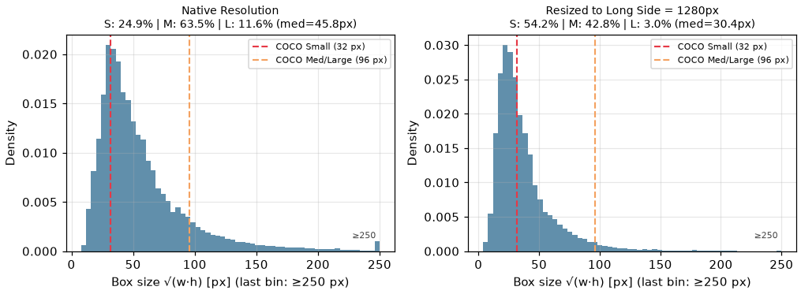
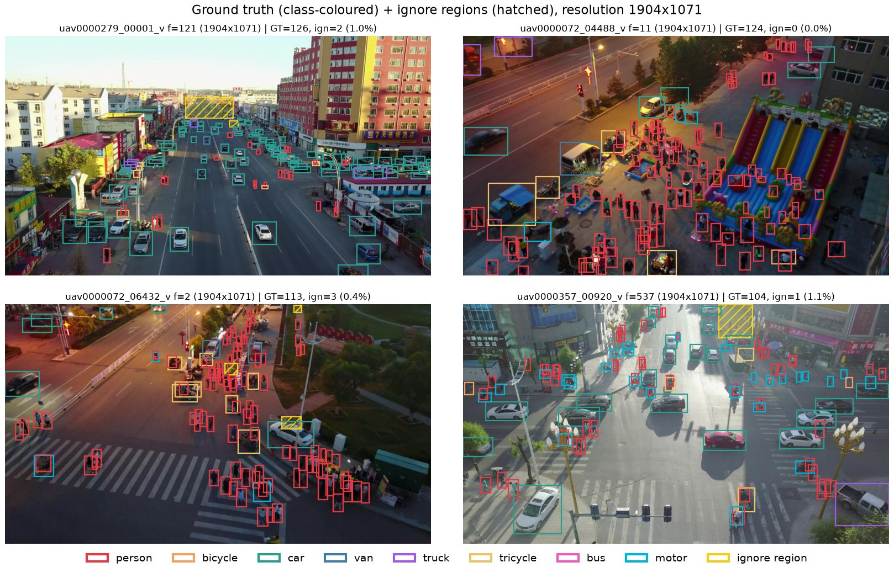
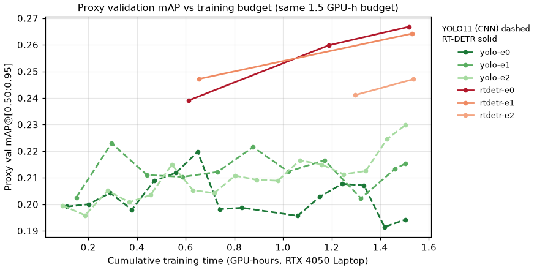
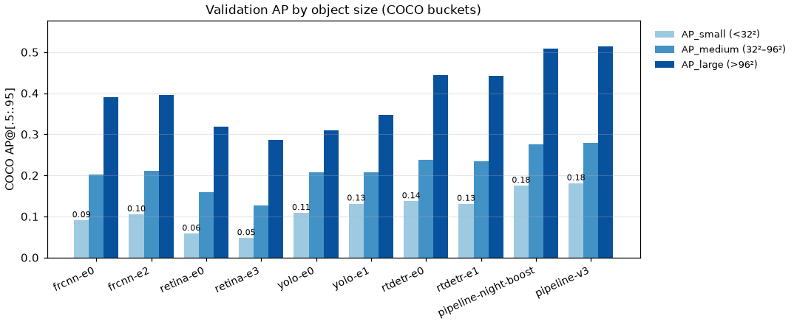
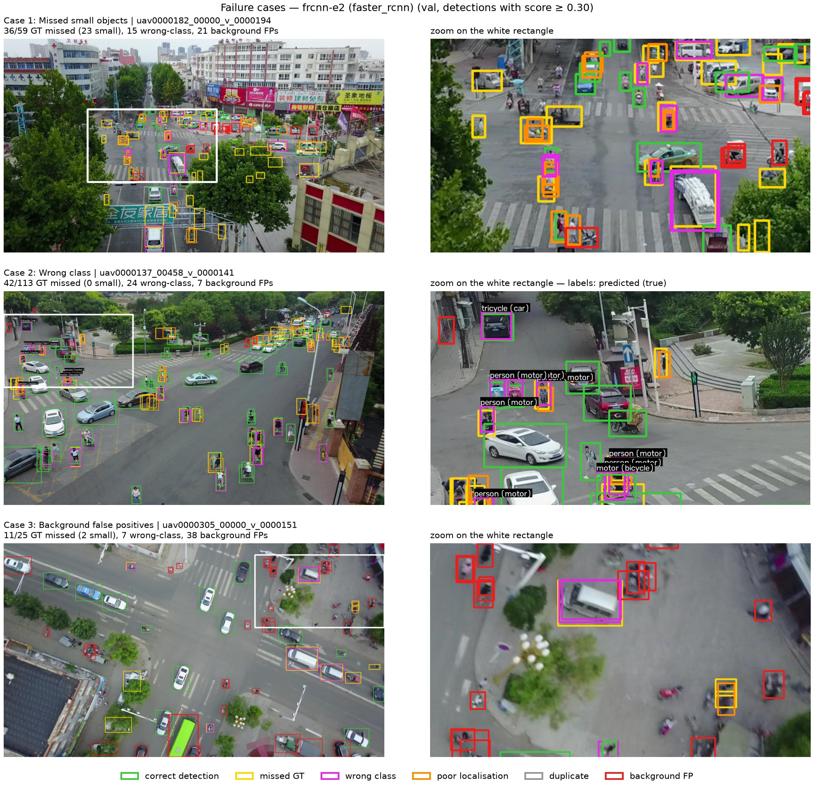
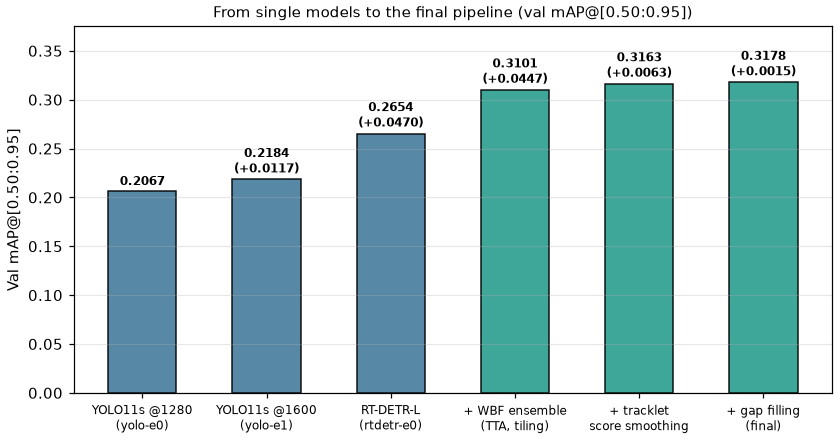

## 1. Task and setup

We detect 8 object classes in every frame of drone videos (VisDrone2019-VID). The metric is COCO mAP@[.50:.95] with ignored regions treated as crowd and up to 500 detections per image. All training ran on Marko's laptop GPU (RTX 4050, 6 GB). For reusability in all notebooks we created a small shared library. All code related to data understanding, training models and conlclusions we located in eight notebooks.

## 2. Data and validation

### Data
Train has 56 clips (24,201 frames, 1.1 million boxes), val - 7 clips, test - 48 clips. A frame has 46 objects on average and up to 180, so we did set parameter of maximum of 500 obj everywhere (the pycocotools default of 100 would cut recall). Cars and persons form 75% of the boxes; bus is only 0.9% of train and only 0.2% of val, which is really a little, so per-class AP for rare classes is noisy. The class mix depends heavily on the scene (highway clips are almost only cars, squares mostly consist of persons). Most objects are small. In the original frames 25% of boxes are COCO-small (under 32x32 px), but we resize frames to 1280 px on the long side, and after that it is 54% (median box side 30 px). That is why we use an input of at least 1280 px (and tried 1600), smaller anchors for Faster R-CNN, and a P2 head. Also about 16% of test frames are 680x382 or 960x540, smaller than any training frame, so objects there have even less details in them.



### Conversion and ignore regions
We verified that the YOLO labels and the COCO JSON (max error of 0.003 px) and that the deduplicated COCO crowd regions align with `ignore/*.txt` (IoU >= 0.9999). Ignore regions are rare: only 0.4-1.9% of labelled boxes fall inside them. To pick a training policy, we ran the same YOLO setup twice: once blurring the regions (keeping labelled boxes sharp) and once just *dropping* them (pixels untouched and no labels added). Dropping did slightly better (AP 0.191 vs 0.187), and blurring caused extra detections along the blur edges, so we kept `drop`. In evaluation, ignore regions are always treated as crowd.



### Split and frame step
We use the official clip-level split (train/val share no clip), because neighbouring frames are near-duplicates: the same object has median IoU 0.90 between consecutive frames. We do'nt use k-fold CV because of compute (one fold already takes 1.5 GPU-hours per model). From the IoU-vs-lag curve we chose a step of k = 5 (median IoU 0.60), which gives 4,868 training frames. Frames larger than 1920 px were downscaled once into a cache.

### Protocol P0
We trained and evaluated all four detector families under the same setup: Each model starts from COCO-pretrained weights and trains on the k = 5 frame cache with ignore regions dropped, at an input size of 1280 px, for at most 1.5 GPU-hours. Augmentation included horizontal flips, random scaling between 0.5 and 1.0, and HSV colour jitter. At inference we use a confidence threshold of 0.001, NMS IoU of 0.6 and keep up to 500 detections per image. The best epoch is chosen on a smaller proxy val set (571 frames), and all reported numbers come from the full val set (2,846 frames at native resolution).

## 3. Detector families

| run | change vs parent | AP | AP50 | AP_s | AR500 | FPS | LB |
|---|---|---|---|---|---|---|---|
| frcnn-e0 | Faster R-CNN R50-FPN v2 baseline | 0.219 | 0.441 | 0.091 | 0.442 | 12.6 | |
| frcnn-e1 | RPN 2x proposals, RoI 1024 @ 0.33, anchors 16-256 | 0.215 | 0.461 | 0.105 | 0.438 | 9.7 | |
| **frcnn-e2** | + GIoU RoI loss | **0.224** | 0.465 | 0.105 | 0.393 | 9.6 | |
| **retina-e0** | RetinaNet baseline | **0.173** | 0.335 | 0.058 | 0.338 | 18.5 | |
| retina-e1 | k-means anchors 10-109 px | 0.069 | 0.199 | 0.038 | 0.255 | 18.7 | |
| retina-e2 | e1 + focal gamma 1.5, IoU 0.4/0.3, GIoU | 0.069 | 0.205 | 0.045 | 0.241 | 18.0 | |
| retina-e3 | e0 + focal gamma 1.5, IoU 0.4/0.3, GIoU | 0.142 | 0.266 | 0.047 | 0.254 | 18.4 | |
| yolo-e0 | YOLO11s @1280 | 0.207 | 0.416 | 0.108 | 0.329 | 55.7 | 0.205 |
| **yolo-e1** | imgsz 1600 | **0.218** | 0.435 | 0.131 | 0.372 | 32.5 | 0.242 |
| yolo-e2 | CIoU + NWD loss | 0.202 | 0.396 | 0.087 | 0.308 | 55.0 | 0.233 |
| **rtdetr-e0** | RT-DETR-L, 300 queries | **0.265** | 0.513 | 0.137 | 0.433 | 9.0 | |
| rtdetr-e1 | 600 queries | 0.261 | 0.501 | 0.131 | 0.501 | 8.8 | 0.268 |
| rtdetr-e2 | e1 + matching cost 1.5/7.5/3, 200 denoising queries | 0.252 | 0.485 | 0.141 | 0.511 | 8.7 | |

### Two-stage (Faster R-CNN)
Faster R-CNN works in two steps: the RPN first suggests candidate regions without caring about the class, and the second stage then classifies each region and refines its box. Because of this, we could check the first stage on its own. In e1 we doubled the number of proposals and halfed the anchor sizes. This raised RPN recall@1000 from 0.86 to 0.94 (and from 0.75 to 0.90 for small objects), and both AP50 and AP_small went up. The downside was worse AP75, and bus AP almost disappeared (0.13 -> 0.02), because the largest anchor was now only 256 px, too small for buses. In e2 we replaced Smooth-L1 with GIoU loss in the RoI head, which brought localisation back and gave our best two-stage model. Proxy AP gets high around epoch 2-3 and then goes down, so picking the best epoch checkpoint really mattered here.

### One-stage anchor-based (RetinaNet)
Without a proposal stage, every one of ~10^5 anchors is classified, which creates extreme foreground/background imbalance. Focal loss handles this, but there is no second refinement step and no proposal filtering, so duplicates and localisation errors are higher. Tuning anchors based on our EDA box sizes failed: k-means anchors fitted on training boxes (mean best IoU 0.65 -> 0.82) collapsed AP to 0.069. The fitted anchors are smaller than the stride at P6/P7, so large vehicles have no anchor near their size (AP_large 0.32 -> 0.09), and the COCO-pretrained regression head no longer matches the anchors. The loss/matching changes alone (e3) also hurt. The tuned two-stage model beats the best one-stage model by +0.051 AP and nearly doubles AP_small at half of the speed.

### One-stage anchor-free (YOLO11)
Ultralytics YOLO makes its predictions at grid points. During training, the task-aligned assigner picks which points count as positives for each box: the top-k points inside it, ranked by classification score x IoU. A small object covers only a few stride-8 cells, so in crowded scenes neighbouring objects end up fighting over the same points. What helped most was simply raising the input resolution (we tried 1280 and 1600). At 1600 we got +0.012 AP, +0.023 AP_small and +0.037 on the LB, but speed dropped from 56 to 33 FPS. We also tried CIoU+NWD loss (with NWD constant C = 24 px), and it lowered both val AP and AP_small. We see a few possible reasons: a fixed C saturates for larger boxes, the assigner still relies on CIoU, and the batch size was different in that run. And strangely the same model scored higher than the baseline on the LB.

### Query-based (RT-DETR-L)
Hungarian matching assigns each object to exactly one query, so the model learns not to produce duplicates and needs no NMS. This avoids suppressing true neighbours in crowds, but each object gives only one positive, so training is slower per epoch. With the same budget, RT-DETR fits only 2-3 epochs (YOLO fits 11-17), its curve is still rising (not converged), still epoch 1 already beats YOLO's final AP. It is best in every density bucket (frames with 70+ objects: 0.342 vs 0.300 for yolo-e0) and ties YOLO@1600 on small objects. Doubling the queries to 600 raised AR500 (0.43 -> 0.50) but not AP, cause it trained one epoch fewer in the budget. The matching-cost and denoising changes gave the best AP_small (0.141) but spent 1.3 GPU-hours in the first epoch.





### Failure cases
1. Missed small objects: in dense intersections most misses are distant pedestrians and motorbikes below 24 px. Misses are 43% of Faster R-CNN's errors and 65% of YOLO's.<br>
2. Class confusion between look-alike classes: van -> car, bicycle <-> motor, motor -> person (a rider on a motorbike looks like a person from above).<br>
3. "Background" false positives that are often real but unlabelled parked bikes and riders. These are gaps in the annotations, which inflates the false positive rate even when the model is right.




## 4. Our pipeline

We separated the effects of data, inference and model changes:

| step | AP before -> after | comment |
|---|---|---|
| data: ignore `blur` -> `drop` | 0.187 -> 0.191 | continued with drop |
| data: k = 2 frames + copy-paste fine-tune (RT-DETR) | 0.265 -> 0.260 | `lr0` was silently ignored by Ultralytics' auto-optimizer |
| inference: TTA (scales 1.0/1.15 + flip), YOLO11m | 0.212 -> 0.221 | +0.002 for RT-DETR |
| inference: tiling 960 px, 25% overlap, yolo-e1 | 0.218 -> 0.218 | AP_small 0.131 -> 0.155, AR500 +0.022 |
| model: P2 head, controlled ablation (04b) | 0.189 -> 0.194 | AR500 +0.061, but 37 vs 53 FPS |
| model: WBF ensemble of 15 inputs (3 families) | best single 0.265 -> 0.310 | |
| temporal: tracklet rescoring + gap filling | 0.310 -> 0.318 | bonus |


We ensembled the models using weighted boxes fusion which averages overlapping boxes from all models instead of discarding them. Even the weaker families added some gain, which shows that diversity matters.


### Temporal post-processing
 Because we operate with frames from videos we can use tracking for double checking the detections. For each clip and class we link detections in consecutive frames into tracklets. Each score is then mixed with the tracklet's top scores, gaps of <= 2 frames are filled, and boxes are smoothed over 3 frames. This adds +0.008-0.009 AP consistently.



We built the pipeline in three versions and submitted each of them to Kaggle:

| version | what is inside | val AP | public LB |
|---|---|---|---|
| v1 (pipeline-final) | 3 YOLO + 3 RT-DETR models, WBF + temporal | 0.300 | 0.318 |
| v2 (pipeline-night-boost) | 12 inputs: v1 + bigger YOLO, P2 head, TTA and tiling | 0.313 | 0.337 |
| v3 (pipeline-v3) | v2 + 3 Faster R-CNN models | 0.318 | 0.327 |

For comparison, our single models scored 0.205-0.242 (YOLO) and 0.268 (RT-DETR) on the public LB. Interestingly v3 is the best on val but not on the LB. The public LB uses only part of the test clips, and we tuned the pipeline on the same 7 val clips, so we don't fully trust either number.


## 5. What did not work

1. Custom anchors for RetinaNet made it worse, with AP going from 0.173 to 0.069
2. Special loss normalized wasserstein distance in YOLO lowered val but perfomed better on the leaderboad. 
3. More complex settings for RT-DETR made it run slower, so with the fixed timeout model was undertrained
4. Cutting images into tiles didn't help as it found more small objects but also created broken and duplicate boxes.

## 6. Final model and how to run

Our final submission is pipeline-v3. Our final ensemble consists of three kinds of detectors - RT-DETR, YOLO, Faster R-CNN. Their output is then merged with wighted boxes fusion. It has 0.318 AP on val and 0.327 on the public leaderboard.

How to run:
1. Install requirements

```bash
python -m venv .venv && source .venv/bin/activate
pip install -r requirements.txt && pip install -e .   
```

2. Download data from Kaggle to the data folder
3. Run all the notebooks in order, notebook 6 creates final submission (`submissions/pipeline_v3.csv`)

We used seed 42 in every notebook and every run, so the results can be repeated. All other settings are written directly in the notebooks, and each run also saves its full config to `experiments/runs/<run_id>/config.yaml`.


## 7. Conclusions


Because the dataset consists of shots taken from air objects on frames are dense and tiny, that makes them difficult to detect. We saw that detector family matters. Evidence for that is that RT-DETR-L beat every CNN even though it had not fully converged. We made some tuning and the one that helped the most was raising input resolution and adding a stride-4 detection head, because tiny objects became bigger and got more grid cells, and therefore easier to detect. The largest gains came from ensembling three detector families and merging their results.

## References

Papers and tools we used ideas or code from:

1. Ren et al. Faster R-CNN (2015) - https://arxiv.org/abs/1506.01497
2. Lin et al. Feature Pyramid Networks (2017) - https://arxiv.org/abs/1612.03144
3. Lin et al. Focal Loss / RetinaNet (2017) - https://arxiv.org/abs/1708.02002
4. Redmon, Farhadi. YOLOv2, k-means anchors (2016) - https://arxiv.org/abs/1612.08242
5. Feng et al. TOOD, task-aligned assigner (2021) - https://arxiv.org/abs/2108.07755
6. Carion et al. DETR (2020) - https://arxiv.org/abs/2005.12872
7. Zhao et al. RT-DETR (2023) - https://arxiv.org/abs/2304.08069
8. Rezatofighi et al. GIoU (2019) - https://arxiv.org/abs/1902.09630
9. Zheng et al. DIoU/CIoU (2019) - https://arxiv.org/abs/1911.08287
10. Wang et al. Normalized Wasserstein Distance (2021) - https://arxiv.org/abs/2110.13389
11. Solovyev et al. Weighted Boxes Fusion (2019) - https://arxiv.org/abs/1910.13302
12. Akyon et al. SAHI, sliced inference (2022) - https://arxiv.org/abs/2202.06934
13. Han et al. Seq-NMS (2016) - https://arxiv.org/abs/1602.08465
14. Bolya et al. TIDE (2020) - https://arxiv.org/abs/2008.08115
15. Zhu et al. VisDrone dataset (2020) - https://arxiv.org/abs/2001.06303
16. Ultralytics (YOLO11 and RT-DETR training) - https://docs.ultralytics.com/
17. TorchVision detection models and reference scripts - https://github.com/pytorch/vision/tree/main/references/detection
18. faster-coco-eval (evaluation) - https://github.com/MiXaiLL76/faster_coco_eval
19. ensemble-boxes (WBF implementation) - https://github.com/ZFTurbo/Weighted-Boxes-Fusion
